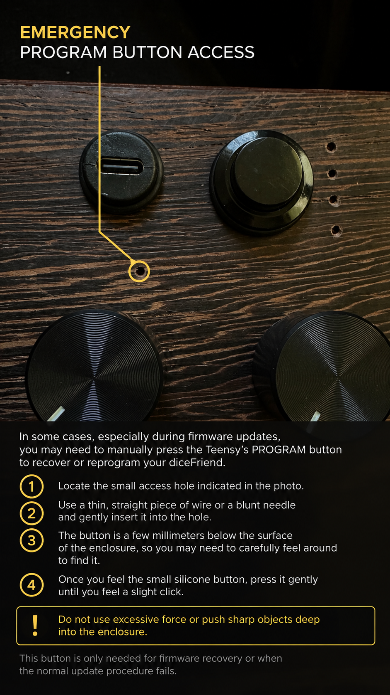

# Emergency PROGRAM button access

If the normal firmware update procedure fails, manually press the Teensy's PROGRAM button through the small emergency access hole in the diceFriend enclosure.

The button requests programming/bootloader mode. It is not an ordinary restart button. Use this method for firmware recovery when the normal update methods are unavailable.

1. Locate the small access hole circled in the photo, below and slightly to the right of the USB-C port.
2. Use a thin, straight piece of wire or a blunt needle and gently insert it into the hole.
3. The button is a few millimetres below the surface. Carefully locate the small silicone button without pushing the tool deep into the enclosure.
4. Press gently until you feel a slight click, then remove the tool. Continue programming with Teensy Loader and the selected HEX file.

Do not use excessive force or push sharp objects deep into the enclosure.

For routine SixOp_OS updates, first try normal upload, the Serial BOOTLOADER command, SH + DICE for 10 seconds, or the power-up rescue gesture described in the source. The physical access method is available when software recovery does not work.
